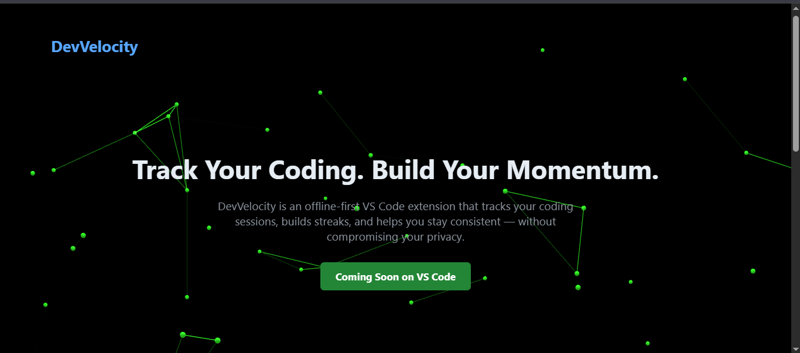
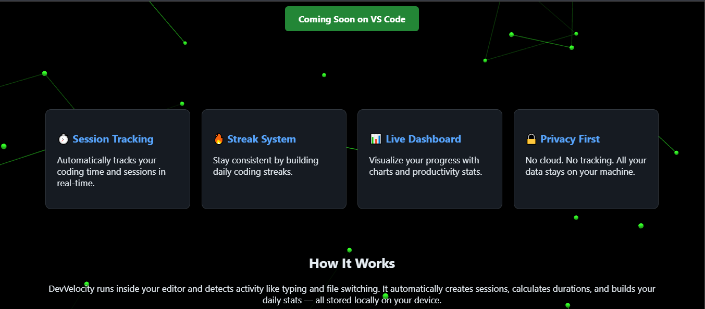

# DevVelocity

DevVelocity is an offline-first Visual Studio Code extension that records coding sessions and displays personal activity statistics. It detects document edits and active-editor changes, ends a session after five minutes without activity, and presents daily and seven-day summaries, including a coding streak.

Session history is stored locally in VS Code extension state; the extension does not send session data to a backend. The dashboard loads Chart.js from jsDelivr at runtime to render charts, so those charts require network access.




## Tech Stack & Architecture

- **Language:** TypeScript, compiled to CommonJS JavaScript targeting ES2020.
- **Host platform:** Visual Studio Code Extension API. The extension activates after VS Code startup.
- **Build tooling:** npm and TypeScript (`tsc`); source files in `src/` compile to `out/`.
- **Activity tracking:** VS Code document-change and active-editor-change events feed the session manager.
- **Session lifecycle:** `SessionManager` starts a session on the first activity event and closes it after more than five minutes without activity. An extension-level timer checks for idle sessions every 30 seconds.
- **Persistence:** `vscode.ExtensionContext.globalState` stores session records locally. No database or separate service is used.
- **Dashboard:** A VS Code webview calculates and displays daily totals, session count, current streak, and charts for the past seven days. The charts use Chart.js from `https://cdn.jsdelivr.net/npm/chart.js`.
- **Debug commands:** Additional commands show and validate saved sessions, clear session data after confirmation, and add a simulated session.

## Prerequisites & System Requirements

- **Visual Studio Code 1.80.0 or later** to run the extension; the extension manifest specifies `^1.80.0`.
- **Node.js 14.17.0 or later** for the locked TypeScript toolchain (TypeScript 5.9.3 declares Node.js `>=14.17`).
- **npm 9 or later** to use the lockfile version 3 with `npm ci`.
- Git to clone the repository.

No separate database, runtime service, environment variables, or worker process is required.

## Step-by-Step Local Setup & Installation

1. Clone the repository and enter its directory:

   ```sh
   git clone https://github.com/jpb17387/DevVelocity.git
   cd DevVelocity
   ```

2. Install the exact dependency versions recorded in `package-lock.json`:

   ```sh
   npm ci
   ```

3. There is no `.env.example` or `.env` configuration. No environment variables are read by the extension, so no environment-file setup is needed.

4. There is no database to install or initialize. Session records are created and maintained in VS Code's extension `globalState` as the extension runs.

5. Compile the TypeScript source:

   ```sh
   npm run compile
   ```

   This runs `tsc -p ./` and writes compiled extension files to `out/`.

## Running the Project Locally

1. Open the repository folder in Visual Studio Code.
2. Press **F5** (or select **Run > Start Debugging**) to launch the **Extension Development Host**. The checked-in `.vscode/launch.json` runs the extension, and its pre-launch build task runs `npm run compile`.
3. In the Extension Development Host, open the Command Palette (`Ctrl+Shift+P` on Windows/Linux or `Cmd+Shift+P` on macOS) and run **DevVelocity: Show Stats**.
4. Edit a document or switch the active text editor to generate activity. After more than five minutes of inactivity, the session is saved locally. The dashboard reads the stored sessions when it opens.

For development, `npm run watch` continuously recompiles TypeScript as files change. Stop it with **Ctrl+C**. There is no standalone web server, separate backend, production-start script, or background worker in the package scripts.

The package defines no automated test suite: `npm test` is a placeholder that exits with an error.

## Project Structure

```text
DevVelocity/
├── .vscode/                 # Extension debugging launch configuration and build task
├── Animation_HTML/          # Animation library asset
├── Info_for_the_Project/    # Project roadmap and walkthrough notes
├── out/                     # Compiled JavaScript and source maps (generated by compile)
├── public/
│   ├── assets/              # Extension logo
│   └── images/              # README previews and other images
├── src/
│   ├── dashboard/           # Dashboard statistics and webview
│   ├── debug/               # Session inspection, clearing, and simulation commands
│   ├── storage/             # Local session persistence via VS Code globalState
│   ├── tracker/             # Activity detection and session lifecycle
│   └── extension.ts         # Extension activation and component wiring
├── .gitignore               # Git ignore rules
├── .vscodeignore             # Files excluded from VSIX packaging
├── LICENSE                  # Project license terms
├── landingpage.html         # Project landing page
├── package.json             # Extension metadata, dependencies, and npm scripts
├── package-lock.json        # Locked npm dependency versions
├── tsconfig.json            # TypeScript compiler configuration
├── devvelocity-vscode-extension-1.0.0.vsix  # Prebuilt extension package
└── README.md
```

`node_modules/` is created by `npm ci` and is not part of the source tree. The repository also contains a prebuilt `.vsix` package; the development workflow above builds and launches the checked-out source instead.

## Usage

Available commands in the Command Palette:

- **DevVelocity: Show Stats** — open the activity dashboard.
- **DevVelocity: Show Raw Sessions** — validate and display saved session data in the DevVelocity Debug output channel.
- **DevVelocity: Clear Sessions** — clear saved session data after confirmation.
- **DevVelocity: Simulate Session** — add a simulated session for dashboard/debugging purposes.

The extension records activity timestamps and session durations, not the contents of edited files.

## Privacy & Network Behavior

Session records are saved in the local VS Code extension state and are not uploaded to a project service. The dashboard requests Chart.js from jsDelivr when it renders charts; without network access, locally stored activity remains available but the CDN-hosted chart library may not load.

## License

See the repository's [LICENSE](./LICENSE) file.

## Project Links

- [Project landing page](https://jpb17387.github.io/DevVelocity/landingpage.html)
- [Repository](https://github.com/jpb17387/DevVelocity)
